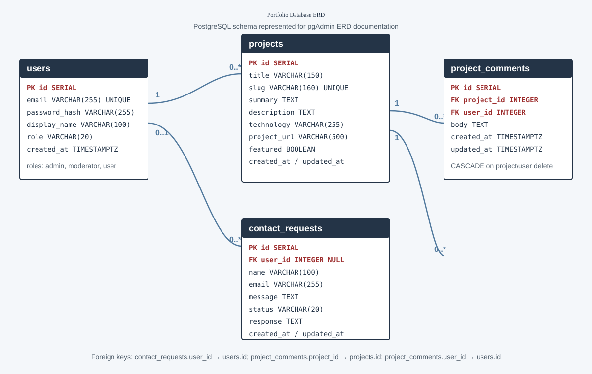

# William Torman Portfolio

## Project Description

This project is a server-rendered personal portfolio for William Torman, a
software engineering student and developer. Visitors can browse featured
projects, read project details, submit contact requests, and leave comments
after creating an account. The site is intended for prospective employers,
clients, collaborators, and anyone evaluating the author's software projects.

The application uses Node.js, Express, EJS, PostgreSQL, and session-based
authentication.

## Database Schema

The PostgreSQL schema is defined in [`src/db/schema.sql`](src/db/schema.sql).
The ERD image below documents the tables and their relationships.

The database contains:

- `users`: accounts, password hashes, display names, and roles.
- `projects`: portfolio project content and publication metadata.
- `project_comments`: authenticated user comments associated with projects.
- `contact_requests`: visitor messages, optional user associations, statuses,
  and responses.

## User Roles

| Role | Capabilities |
| --- | --- |
| **User** | Register, sign in, view projects, submit contact requests, and post project comments. A user can view their own dashboard activity. |
| **Moderator** | Everything a user can do, plus view and update contact request status and responses. |
| **Admin** | Everything a moderator can do, plus create, edit, and delete projects and change any user's role. Admins can view all users and projects in the dashboard. |

New registrations receive the `user` role. Roles are stored in the `users.role`
column and can only be changed by an admin.

## Test Account Credentials

Use the following test accounts when the database has been populated with the
course/development seed data:

| Role | Email |
| --- | --- |
| Admin | `admin@example.com` |
| Moderator | `moderator@example.com` |
| User | `user@example.com` |

The password is intentionally omitted from this README. All three test
accounts use the password supplied for the application's test environment.

## Setup

1. Copy the environment configuration into `.env` and set `DATABASE_URL` and
   `SESSION_SECRET`.
2. Install dependencies with `npm install`.
3. Initialize PostgreSQL with `npm run db:init`.
4. Start the development server with `npm run dev`.
5. Open <http://localhost:3000>.

Set `ADMIN_EMAIL` and `ADMIN_PASSWORD` before running `npm run db:init` to
create or update the administrator account. The application stores only a
bcrypt password hash.

## Known Limitations

- There is no password reset, email verification, or email notification
  workflow.
- Contact requests are stored in PostgreSQL; submitting one does not send an
  email automatically.
- The application does not currently include automated unit or integration
  tests.
- Forms do not yet include CSRF tokens, so deployment should be paired with
  an appropriate CSRF protection strategy.
- The ERD documents the application tables; `connect-pg-simple` may also create
  its session table when the server first starts.
